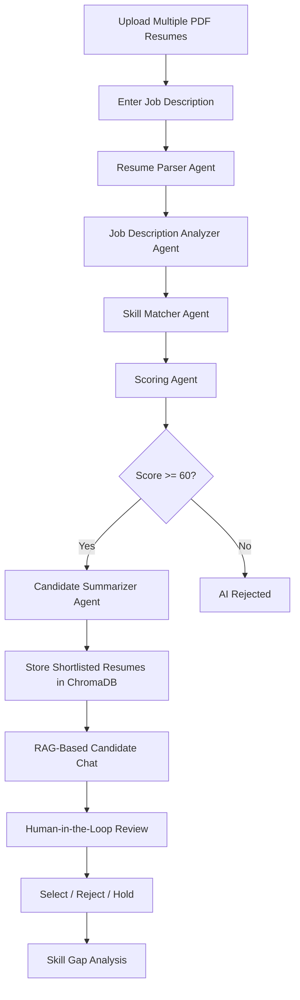

# 📄 AI Resume Analyser – Multi-Agent Resume Screening System

An AI-powered resume screening application that evaluates multiple candidate resumes against a given Job Description (JD) using **Google Gemini, LangGraph, RAG, and Human-in-the-Loop (HITL)** decision-making.

🔗 **Live Demo:** [AI Resume Analyser](https://ai-resume-screening-system-uuukobaaffsjyymajxbaiu.streamlit.app/)

---

## 🚀 Project Overview

Recruiters often receive hundreds of resumes for a single job opening. Manually reviewing each resume can be time-consuming and may lead to inconsistent evaluations.

The **AI Resume Analyser** aims to simplify this process through a multi-agent AI workflow. It analyses resumes, identifies relevant skills and experience, evaluates candidate suitability, and generates structured evaluation results based on the provided job description.

The application also incorporates a Human-in-the-Loop approach, allowing human reviewers to participate in candidate decisions rather than relying entirely on AI recommendations.

## ✨ Key Features

- **Multiple Resume Upload:** Upload multiple PDF resumes for simultaneous evaluation.
- **Job Description Analysis:** Understands the job requirements and identifies important qualifications.
- **Resume Parsing:** Extracts relevant information, skills, experience, and candidate details.
- **Multi-Agent Architecture:** Uses specialized AI agents for different stages of resume evaluation.
- **AI-Based Candidate Scoring:** Evaluates candidates across three dimensions:
  - Skills Match – 40 points
  - Relevant Experience – 35 points
  - Project Alignment – 25 points
- **Candidate Ranking:** Identifies the highest-scoring candidate based on AI evaluation.
- **Candidate Summarization:** Generates structured summaries highlighting strengths and weaknesses.
- **RAG-Based Candidate Analysis:** Uses ChromaDB to retrieve relevant information from shortlisted resumes.
- **Interactive AI Chat:** Enables users to ask questions about shortlisted candidates.
- **Human-in-the-Loop (HITL):** Allows reviewers to select candidates, reject all, or put candidates on hold.
- **Skill Gap Analysis:** Identifies gaps between candidate qualifications and job requirements.

## 🏗️ System Architecture

The application follows a multi-agent workflow orchestrated using LangGraph.



### 🤖 AI Agents

| Agent | Responsibility |
|---|---|
| Resume Parser Agent | Extracts structured information from resumes |
| JD Analyzer Agent | Analyses job requirements and qualifications |
| Skill Matcher Agent | Matches candidate skills with job requirements |
| Scoring Agent | Calculates candidate scores based on defined criteria |
| Summarizer Agent | Generates candidate summaries, strengths, and weaknesses |
| Gap Analyzer Agent | Identifies missing skills and qualification gaps |

**Workflow Orchestration:** LangGraph manages the sequence of agent execution and conditional routing based on candidate scores.

## 🛠️ Tech Stack

| Technology | Purpose |
|---|---|
| Python | Core programming language |
| Streamlit | Interactive web application |
| Google Gemini 2.5 Flash | LLM-powered resume analysis |
| Gemini Embeddings | Text embedding generation |
| LangChain | LLM integration and document processing |
| LangGraph | Multi-agent workflow orchestration |
| ChromaDB | Vector database for resume retrieval |
| PyPDF | PDF text extraction |
| Pandas | Data handling |

## 📊 Candidate Evaluation Methodology

Each candidate receives a score out of 100.

| Evaluation Criteria | Maximum Score |
|---|---:|
| Skills Match | 40 |
| Relevant Experience | 35 |
| Project Alignment | 25 |
| **Total** | **100** |

Candidates scoring below 60 are marked as AI-rejected, while candidates scoring 60 or above proceed to the summarization and shortlisted-candidate workflow.

*Note: The scoring threshold is an application-defined rule, not a validated hiring standard. Final hiring decisions should involve human review.*

## 🧠 RAG-Based Candidate Analysis

The application integrates Retrieval-Augmented Generation (RAG) using ChromaDB.

The process involves:

1. Extracting text from shortlisted resumes.
2. Converting resume content into vector embeddings.
3. Storing document embeddings in ChromaDB.
4. Retrieving relevant resume information based on user queries.
5. Using the retrieved context to generate AI responses.

This enables users to ask questions about shortlisted candidates without manually searching through every resume.

## 👤 Human-in-the-Loop (HITL)

The system incorporates human review to support informed recruitment decisions.

Available actions include:

- **Select Candidate:** Choose candidates for further consideration.
- **Reject All:** Reject all shortlisted candidates.
- **Put on Hold:** Temporarily hold the selection decision.
- **Skill Gap Analysis:** Review missing skills and areas requiring improvement.

The purpose of HITL is to keep human judgment involved in the recruitment process.

## ⚙️ Installation & Setup

### 1. Clone the Repository

```bash
git clone https://github.com/YOUR_USERNAME/ai-resume-screening-system.git

cd ai-resume-screening-system
```

### 2. Create a Virtual Environment

```bash
python -m venv venv
```

Activate it:

**Windows**
```bash
venv\Scripts\activate
```

**Mac/Linux**
```bash
source venv/bin/activate
```

### 3. Install Dependencies

```bash
pip install -r requirements.txt
```

### 4. Configure Google Gemini API Key

Generate your API key from [Google AI Studio](https://aistudio.google.com/apikey).

The application accepts the API key through the Streamlit sidebar.

### 5. Run the Application

```bash
streamlit run app.py
```

Open the local URL provided by Streamlit in your browser.

## 🔐 API Key Security

- Never upload your API key to GitHub.
- Do not hardcode API credentials in the source code.
- Use Streamlit Secrets or secure environment variables for deployment.

## 📁 Project Structure

```text
ai-resume-screening-system/
│
├── app.py
├── requirements.txt
├── README.md
└── chroma_db/          # Local vector database (created at runtime)
```

## 🔮 Future Enhancements

- Add OCR support for scanned PDF resumes.
- Introduce advanced candidate ranking and comparison.
- Store human review decisions in a persistent database.
- Add recruiter feedback to improve evaluation criteria.
- Support DOCX resume uploads.
- Improve structured resume extraction and validation.
- Add candidate evaluation reports and downloadable results.

## ⚠️ Limitations

- Resume extraction currently depends on selectable PDF text; scanned documents may require OCR.
- AI-generated scores and summaries may contain inaccuracies.
- Candidate evaluations depend on the quality and completeness of the supplied job description and resumes.
- Human review remains important before making recruitment decisions.

## 👩‍💻 Author

**Shivani Singh**

Data Analytics & Data Science Enthusiast

🔗 [Live Project – AI Resume Analyser](https://ai-resume-screening-system-uuukobaaffsjyymajxbaiu.streamlit.app/)

---

⭐ If you find this project interesting, consider giving the repository a star!

